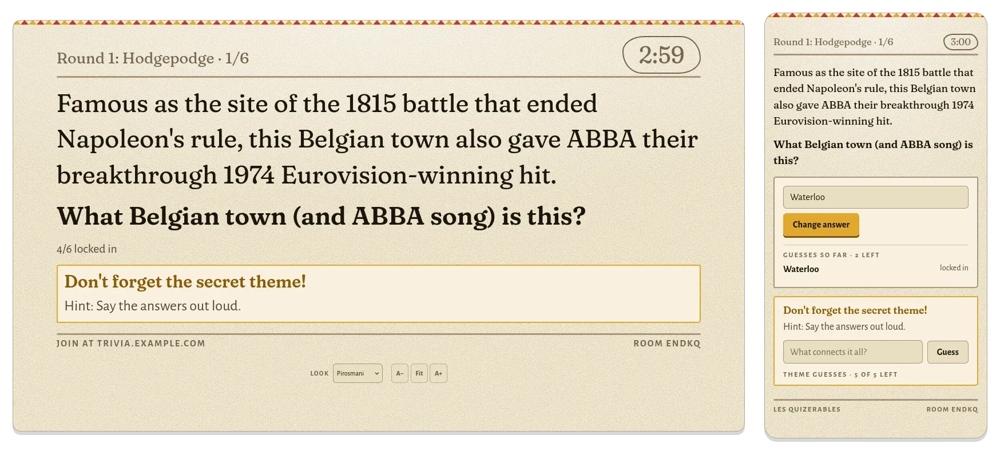
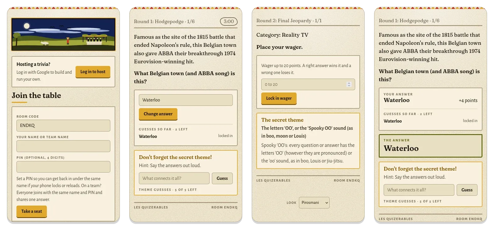
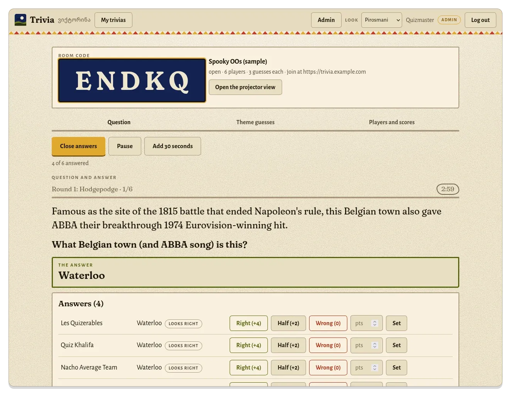
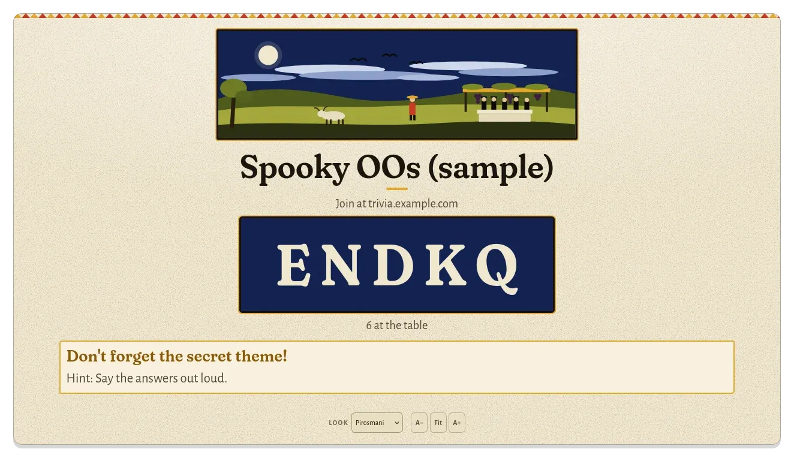
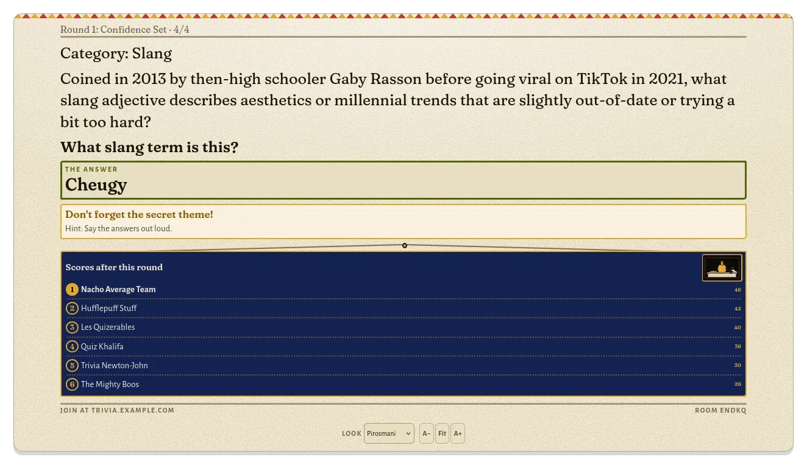
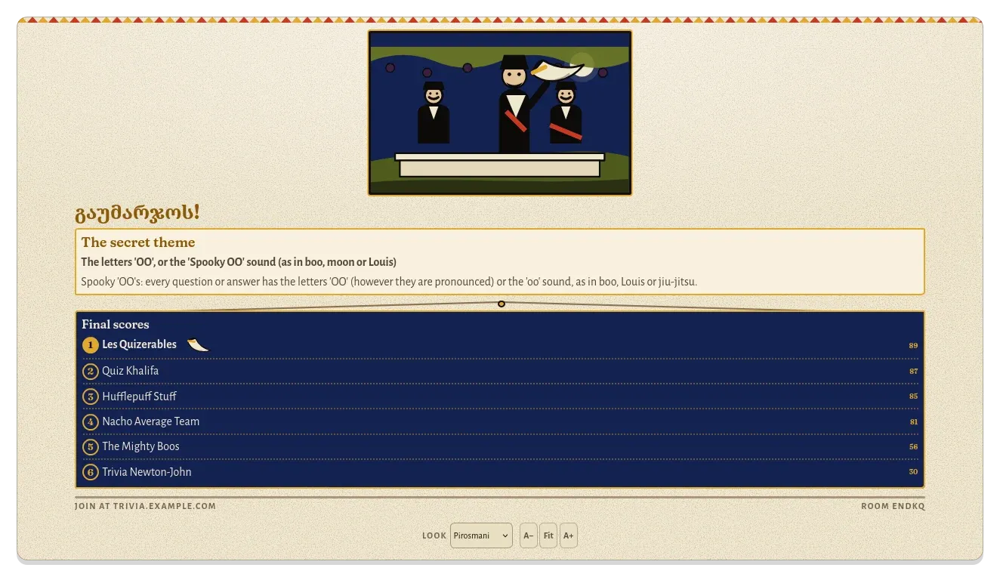
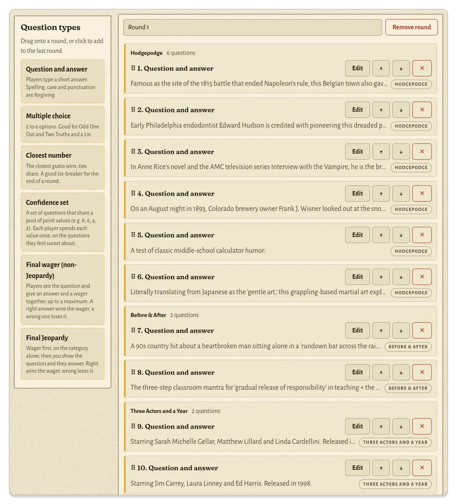
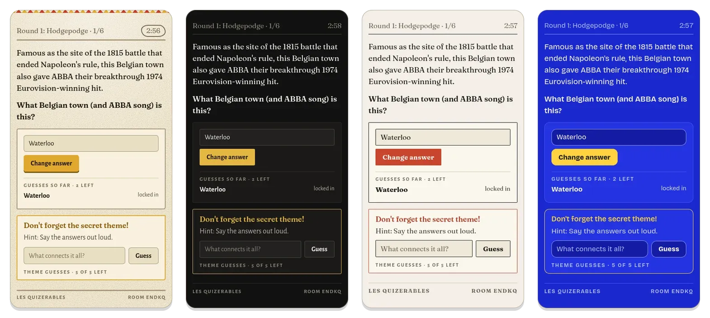
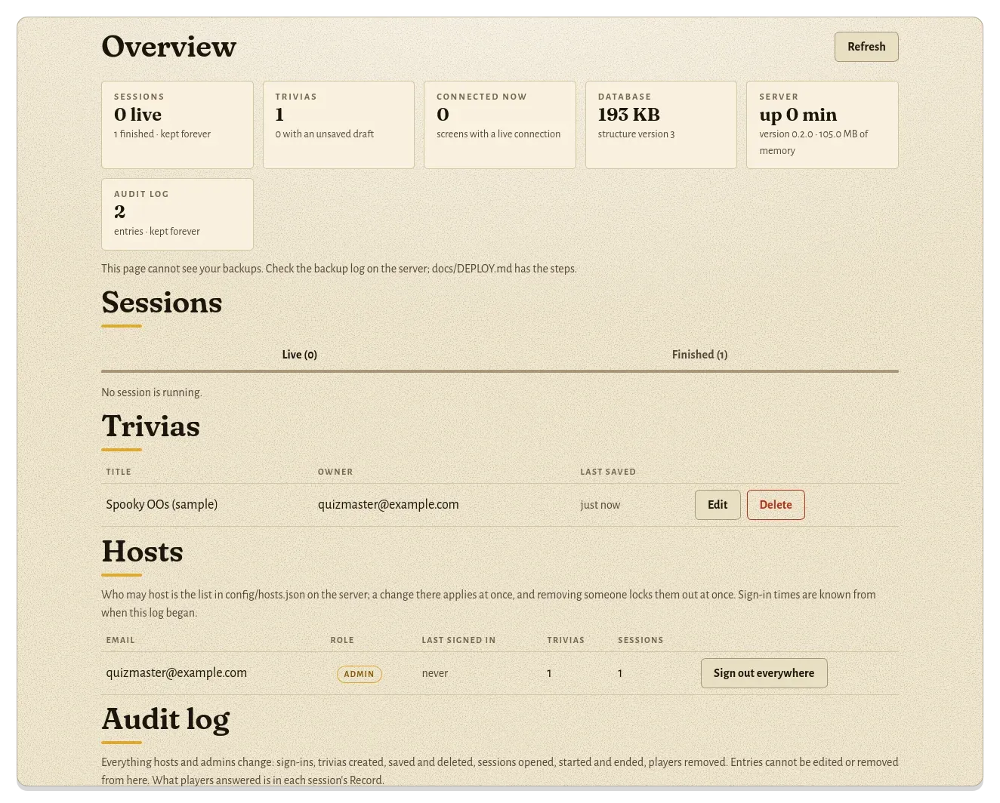
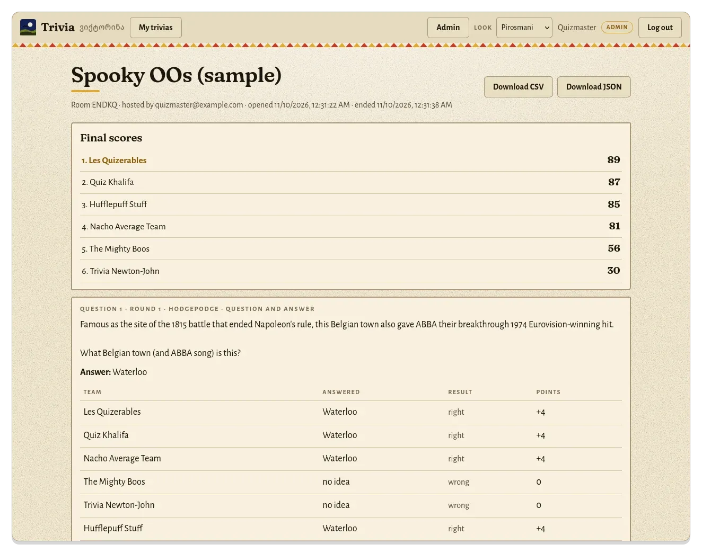

# Supra Trivia

A live trivia night you host yourself. The host builds a trivia in the browser and runs it from a console, the questions go up on a TV, and everyone else plays on their own phone by typing a room code and a team name. Nobody but the host needs an account.

<p align="center"></p>

It is built for the kind of night that happens in a living room or a bar: anything from a handful of teams to a hundred, a host who wants to spend the evening running the game instead of fighting the software, and a question set that has been written with care. It is one small Node server and one SQLite file, so it runs happily on a spare computer at home.

The screenshots on this page are the bundled sample trivia played by made-up teams.

## What a night looks like

**Players** open the site, type the room code and a name, and sit at the table. Each question shows on their phone with a countdown. They lock in an answer, can change it until the guess limit runs out, and see nothing about right or wrong until the host reveals the answer. Scoreboards appear only at the end of a round and at the end of the game, so nobody watches a score move mid-round.

<p align="center"></p>

A team can share one answer across several phones: everyone joins with the same name and PIN, and from then on those phones are one player with one guess allowance and one score ([Playing as a team](docs/TEAMS.md)). A PIN also gets a phone back in after a reload or a dead battery.

A trivia can hide a **secret theme** that links the questions. Players guess it whenever they like, the host approves the right guesses, and the bonus is held back until the theme goes public.

**The host** runs everything from the console. Every question moves through the same four steps (open, closed, revealed, next), the console only ever offers the next one, and the server enforces the order too, so a stale tab cannot skip a step.

<p align="center"></p>

- Answers arrive as they are sent. The console marks the ones that match an accepted answer with **Looks right** and the rest with **no match**; the host confirms with **Right**, **Half** or **Wrong**, or types any amount.
- The countdown is 3 minutes by default, set per trivia or per question. The host can add 30 seconds, close early, or **Pause** for an interruption; paused time is not taken from the players.
- Theme guesses, players and scores each have their own tab, with a red dot when a new guess arrives. The host can remove a player, close the room to newcomers, or let a locked-out team back in.
- **End session** sits apart from the step buttons so it cannot be hit by accident.

**The TV** gets its own page. It fits itself to the screen, so a long question shrinks just enough to stay on one screen, and it shows the room code while people arrive, the question and countdown while it is open, and the scores after each round.

<table>
  <tr>
    <td width="33%"></td>
    <td width="33%"></td>
    <td width="33%"></td>
  </tr>
  <tr>
    <td align="center">Waiting for teams</td>
    <td align="center">Scores after a round</td>
    <td align="center">Final scores</td>
  </tr>
</table>

More on running a game, including the timer, pausing and the projector: [docs/HOSTING.md](docs/HOSTING.md).

## Building a trivia

A trivia is a list of rounds, and a round is a list of questions. The builder is a form: drag a question type onto a round (or click it), fill in the boxes, and save. Nothing needs to be learned first, and every box has an example in it.

<p align="center"></p>

| Question type | How it plays |
|---|---|
| Question and answer | Players type a short answer. Case, punctuation and other accepted spellings are forgiven. Points in halves |
| Multiple choice | Two to six options |
| Closest number | The closest guess wins and ties share. A good tie-breaker for the end of a round |
| Confidence set | A run of questions that share a list of values such as 8, 6, 4, 2. Each team spends each value once, on the question it feels surest about |
| Final wager | Answer and wager go in together. Right wins the wager, wrong loses it |
| Final Jeopardy | Teams see only the category and lock in a wager first. The host then shows the question and the answer clock starts |

Questions can carry a **section** label ("Before & After", "Three Actors and a Year"), which numbers them 1/6, 2/6 and so on and groups them in the builder. Each question can also have a fun fact shown at the reveal, its own time limit and its own guess limit. The full list is in [docs/MODULES.md](docs/MODULES.md).

Things the builder does for you:

- **A worked example.** Every host starts with **Spooky OOs (sample)**, a 29-question night with two rounds, a secret theme, a confidence set in each round and a final Jeopardy. It is their own copy to edit or delete.
- **Nothing is lost.** Unsaved work is cached in the browser and backed up to the server as a draft, and the builder offers it back after a crash or on another device. Saving over a version that changed elsewhere asks first.
- **Reuse.** Duplicate any trivia, or export and import it as JSON.
- **Writing advice.** The app is built around a set of trivia-writing rules: a famous answer with a lateral clue, a round curve of layups, sweet spots and stretches, and a quality checklist ([docs/GUIDELINES.md](docs/GUIDELINES.md), [docs/THEME_BANK.md](docs/THEME_BANK.md)).

## Four looks

The look is chosen per device, so the TV, the host and every phone can differ. The default takes its palette from the paintings of Niko Pirosmani: black oilcloth, ochre, midnight blue and a cream tablecloth. There is a quieter supper-club look, a printed-quiz-sheet look and a bright game-show look. Fonts are bundled, so nothing is loaded from a third party.

<p align="center"></p>

Details and how to add a look: [docs/DESIGN.md](docs/DESIGN.md).

## Records and oversight

Hosts sign in with Google, and only the emails listed in `config/hosts.json` are accepted. The project owner is an **admin**, who can see and control every session and can sign any host out everywhere.

<p align="center"></p>

- **Session record.** When a question finishes, the app files what every team answered, whether it was right, the points, every guess in order and any wager. Finished sessions are kept until you say otherwise, and the record downloads as CSV or JSON.
- **Audit log.** Sign-ins, trivia changes, sessions opened and ended, players removed, and anything an admin does in someone else's account, each with the time and the address it came from.
- **Server log.** One JSON line per change, refusal or fault. Sign-in codes, PINs and answers are never written to it.

<p align="center"></p>

What is kept, for how long, and how to change it: [docs/LOGGING.md](docs/LOGGING.md).

## Rules the server keeps

The phone is never trusted. Wagers, confidence values, guess counts, answer times and question order are all checked on the server, and each limit has an automated test that tries to get past it ([docs/LIMITS.md](docs/LIMITS.md)). Final Jeopardy wagers are held by the server from the moment they are placed, so a modified phone cannot change one after seeing the question.

Other protections: sign-in cookies are signed and can be revoked, requests are checked against the site's own address, every route is rate limited by the visitor's real address (only proxies you list are believed), stored games are validated when they load, and the container shuts down cleanly. Scoring rules are in [docs/SCORING.md](docs/SCORING.md).

## Running it yourself

You need Node 20 or newer (or Docker), an https address, and a Google OAuth client so hosts can sign in. There is exactly one running copy: live state is held in memory and the database is a single file, so do not scale it out.

```bash
npm install
cp .env.example .env                              # fill in the values
cp config/hosts.example.json config/hosts.json    # your email under admins
npm run dev
```

For a real deployment, [docs/DEPLOY.md](docs/DEPLOY.md) has ready-made files for each of these:

| You have | Use |
|---|---|
| A server that already runs a reverse proxy | Docker behind your proxy |
| A home server or VPS and nothing else | Docker with Caddy, which handles https automatically |
| A domain on Cloudflare and no open ports | Cloudflare Tunnel |
| A server and no wish to use Docker | Node and systemd |
| No server | Fly.io or another host |

The same page covers backups and restoring them, updating, monitoring and a hardening checklist.

## How it is built

| | |
|---|---|
| Server | Node 20+, TypeScript, Fastify 5, zod for validation, jose for signed sessions |
| Storage | SQLite through better-sqlite3, one file; live games also held in memory and saved after every answer |
| Live updates | Server-sent events to phones, the projector and the console, with a polling fallback when a proxy holds the stream back |
| Front end | Plain JavaScript modules and one stylesheet. No framework and no build step |
| Question types | One file each in `src/modules/`, registered in one place. The builder reads each type's fields from the server, so a new type needs no front-end code |
| Tests | `npm test` runs the suite under `test/`; CI runs the typecheck, the tests on Node 20 and 22, a dependency audit and a Docker build on every push |

## Documentation

| Page | What is in it |
|---|---|
| [HOSTING.md](docs/HOSTING.md) | The order of play, the timer, pausing, the console and the projector |
| [MODULES.md](docs/MODULES.md) | Every question type, sections and confidence sets, and how to add a type |
| [SCORING.md](docs/SCORING.md) | Points, guess limits, manual marking, wagers and the secret theme |
| [TEAMS.md](docs/TEAMS.md) | Several phones playing as one team |
| [GUIDELINES.md](docs/GUIDELINES.md) and [THEME_BANK.md](docs/THEME_BANK.md) | How to write a good trivia, and ideas to start from |
| [ROLES.md](docs/ROLES.md) | Players, hosts and admins |
| [LIMITS.md](docs/LIMITS.md) | Every limit the server enforces |
| [LOGGING.md](docs/LOGGING.md) | The server log, the audit log and session records |
| [DEPLOY.md](docs/DEPLOY.md) | Every way to run it, plus backups and updates |
| [DESIGN.md](docs/DESIGN.md) | The four looks and the Pirosmani design notes |
| [BUGS.md](docs/BUGS.md) | Bugs found and fixed, and how |

## License

[MIT](LICENSE). The bundled fonts keep their own open licences, noted in `public/fonts/README.txt`.
